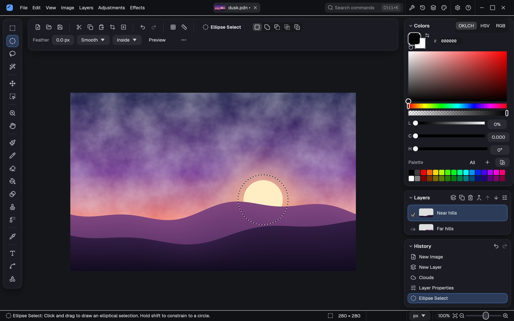
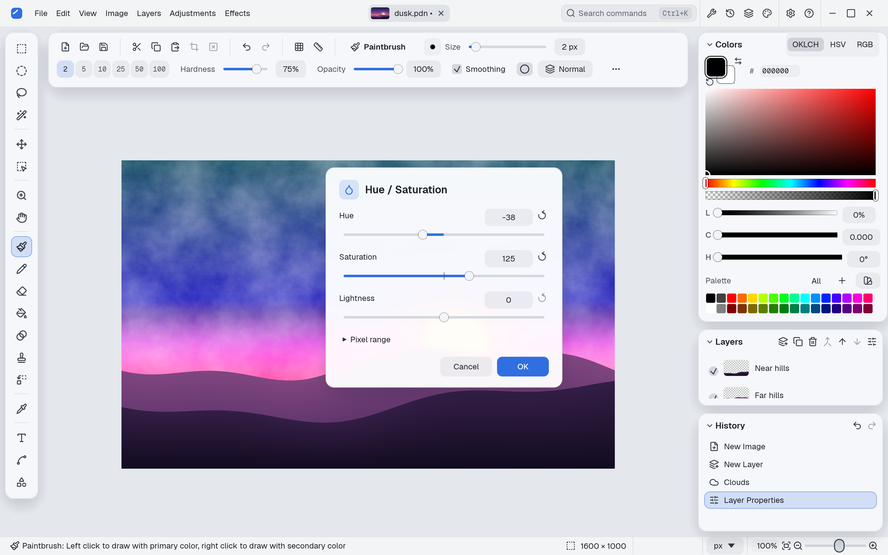
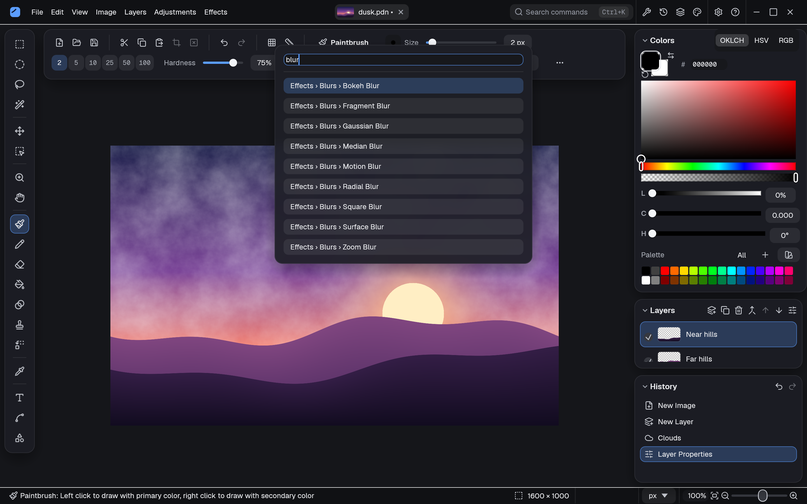
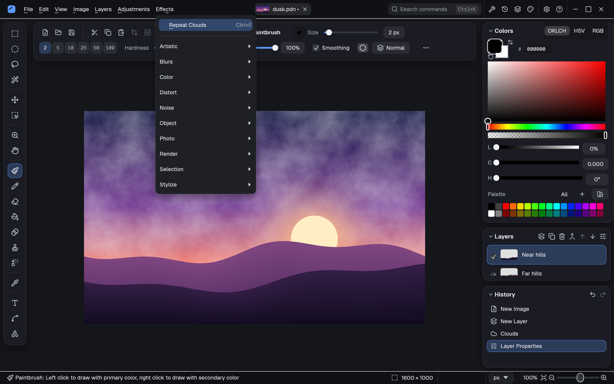

<div align="center">


# paintnotnet

**The paint.net way of editing images, made for Linux.**

Layers, selections, adjustments and effects with paint.net's tools and keyboard shortcuts,
written in Rust and drawn on the GPU so even 24-megapixel photos stay smooth.

[](LICENSE)




</div>

## Why paintnotnet?

paint.net is one of the best-loved image editors on Windows: quick to learn, fast, and
with just enough power. It doesn't run on Linux. paintnotnet brings its way of working
across, with the same tools, menus and shortcuts, so years of muscle memory carry over.
It also adds what a modern editor should have: docked panels, a command palette, dark and
light themes, live previews, and local AI for cutting out subjects.

The editing maths (blend modes, selections, adjustments, effects) is ported from paint.net
3.36's open source code, so results match what you'd expect.

## Features

**Layers**
- paint.net's 14 blend modes, layer opacity and visibility
- Add, duplicate, merge, flip, rotate, reorder; Layer Properties with a live preview

**Selections**
- Rectangle, Ellipse, Lasso and Magic Wand, with Replace, Add, Subtract, Intersect and
  Invert modes
- Live feathering on any selection; Magic Wand tolerance re-runs the last click as you
  change it
- Move, rotate and scale selected pixels, with a pivot you can drag

**Painting and drawing**
- Paintbrush, Pencil, Eraser, Clone Stamp, Recolor, Paint Bucket and Gradient
- Text with your system fonts; Line / Curve and Shapes that stay editable until you finish
- A colour picker with OKLCH, HSV and RGB, plus paint.net's palette

**Adjustments and effects**
- 13 adjustments, including Curves, Levels, Hue / Saturation, Exposure, Highlights /
  Shadows and Temperature / Tint
- 52 effects across Artistic, Blurs, Color, Distort, Noise, Object, Photo, Render,
  Selection and Stylize
- Every dialog previews live on the canvas; sliders are precise (Shift-drag for fine
  control, the mouse wheel and arrow keys step one unit, double-click to reset)

**Remove Background and Select Subject**
- Cut out people, pets and objects with a local AI model (BiRefNet). Nothing is uploaded
- Hair and fur keep clean edges: colour from the old background is removed

**Files**
- Opens and saves paint.net `.pdn` and OpenRaster `.ora` files with their layers
- PNG, JPEG, WebP, BMP, GIF, TIFF and TGA; photos open the right way up
- Copy and paste images with other apps; File › New starts at the size of the image on
  the clipboard

**Comfortable to use**
- paint.net's keyboard shortcuts, rebindable in Settings
- Command palette (Ctrl+K) to find any command by name
- Dark and light themes, KDE Plasma's global menu, Open Recent with thumbnails
- Autosave and crash recovery, so a crash doesn't lose your work

## Screenshots

<table>
  <tr>
    <td width="50%"></td>
    <td width="50%"></td>
  </tr>
  <tr>
    <td align="center"><sub>Adjustments preview live as you drag (light theme)</sub></td>
    <td align="center"><sub>The command palette (Ctrl+K)</sub></td>
  </tr>
  <tr>
    <td colspan="2"></td>
  </tr>
  <tr>
    <td colspan="2" align="center"><sub>Effects, grouped as in paint.net</sub></td>
  </tr>
</table>

## Installing

paintnotnet runs on any Linux desktop with a Wayland or X11 session and a GPU with Vulkan
(or OpenGL). It builds from source with Rust, and has a package recipe
for Arch Linux.

### Arch Linux and derivatives (CachyOS, EndeavourOS, Manjaro…)

```sh
git clone https://github.com/MaxJW/paintnotnet.git
cd paintnotnet/packaging/arch
makepkg -si
```

This builds the latest commit of your clone and installs the `paintnotnet-git` package:
the app, its menu entry and icon, `.pdn` file associations and the AppStream metadata
that software centres show. To update, `git pull` in the clone and run `makepkg -si`
again. To remove it: `sudo pacman -R paintnotnet-git`.

### Any distribution, from source

You need Rust 1.99 or newer (install it with [rustup](https://rustup.rs)), a C compiler
(it builds the bundled WebP library) and git.

```sh
git clone https://github.com/MaxJW/paintnotnet.git
cd paintnotnet
cargo build --release -p paintnotnet
./target/release/paintnotnet
```

To add it to your applications menu for your user only:

```sh
id=uk.co.maxwilson.paintnotnet
install -Dm755 target/release/paintnotnet ~/.local/bin/paintnotnet
install -Dm644 packaging/$id.desktop -t ~/.local/share/applications/
install -Dm644 packaging/paintnotnet.svg ~/.local/share/icons/hicolor/scalable/apps/$id.svg
install -Dm644 packaging/paintnotnet-mime.xml ~/.local/share/mime/packages/$id.xml
update-mime-database ~/.local/share/mime
```

`~/.local/bin` must be on your `PATH`, as it is by default on most distributions.

### What it uses at run time

The program links only the C library. Everything else is loaded when it starts, so a
normal desktop already has it:

| Needed for | Library or service |
|---|---|
| Drawing | A Vulkan driver (or OpenGL) |
| Keyboard input | `libxkbcommon` |
| The window | Wayland's client libraries, or X11's (`libX11`, `libXcursor`, `libXi`, `libXrandr`) |
| Open and Save As dialogs | `xdg-desktop-portal` with your desktop's backend |
| Remove Background and Select Subject (optional) | ONNX Runtime (`onnxruntime`; a CUDA build uses an NVIDIA GPU) |

Remove Background and Select Subject download their model (BiRefNet, from Hugging Face)
the first time you use them, after asking. Settings › AI models shows downloaded models
and deletes them.

## Getting around

If you know paint.net, you already know paintnotnet: the menus, tools and shortcuts are
the same. A few things to try:

| Key | Does |
|---|---|
| Ctrl+K | Find any command by name |
| Ctrl+B | Zoom to fit the window |
| Ctrl+V with no image open | Opens the clipboard image as a new image |
| Shift while dragging a slider | Ten times finer |
| F5 – F8 | Show or hide the Tools, History, Layers and Colors panels |
| Right-click an image tab | Save, Save As or Close that image |

Every shortcut is listed, and can be changed, in Settings › Keyboard.

## Where things are kept

| What | Where |
|---|---|
| Settings, shortcuts, recent files | `~/.config/paintnotnet/settings.toml` |
| Crash recovery (autosave every minute) | `~/.local/state/paintnotnet/recovery/` |
| Session log (for reporting slowness or hangs) | `~/.local/state/paintnotnet/paintnotnet.log` (the previous session's: `.log.1`) |
| Open Recent thumbnails | `~/.cache/paintnotnet/recent/` |
| AI models | `~/.local/share/paintnotnet/models/` |

The `XDG_CONFIG_HOME`, `XDG_STATE_HOME`, `XDG_CACHE_HOME` and `XDG_DATA_HOME` variables move
these as usual.

## Reporting problems

Please [open an issue](https://github.com/MaxJW/paintnotnet/issues) with what you did and
what happened. If the app was slow or froze, attach the session log (above): it records
the commands used, file names, slow frames and memory use, but never image contents.

## Building and developing

The workspace is split into crates:

| Crate | What it holds |
|---|---|
| `apps/paintnotnet` | The app: window, tools, dialogs, menus |
| `crates/pnn-core` | Documents, layers, blending, selections, history |
| `crates/pnn-tools` | Brushes, text, shapes, gradients and tool settings |
| `crates/pnn-effects` | Adjustments and effects |
| `crates/pnn-render` | GPU compositing and display |
| `crates/pnn-io` | File formats, including `.pdn` and OpenRaster |
| `crates/pnn-ai` | Remove Background and Select Subject |
| `crates/pnn-sdf` | Distance fields for feathering |

`cargo xtask ci` runs formatting, Clippy and the tests. `PLAN.md` describes the design and
`ROADMAP.md` what has been built.

## Licences

paintnotnet's code is MIT licensed (see [`LICENSE`](LICENSE)). It includes code ported from
paint.net 3.36 (MIT). The icons are [Lucide](https://lucide.dev) (ISC) and the typeface is
[Geist](https://vercel.com/font) (SIL OFL 1.1). Full details are in [`NOTICE`](NOTICE).

paintnotnet is an independent project. It isn't made or endorsed by dotPDN LLC or the
authors of paint.net. paint.net is a trademark of dotPDN LLC.
